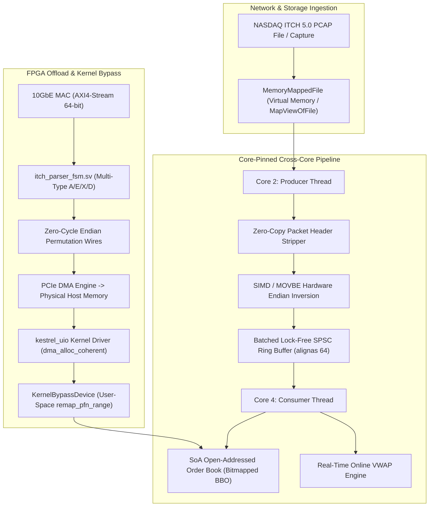
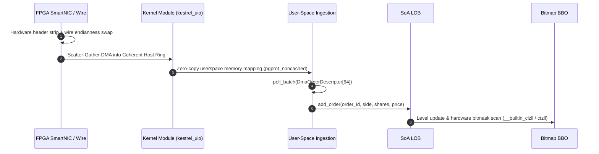

# Kestrel: Wire-Speed NASDAQ ITCH 5.0 PCAP Engine (C++20 / SIMD / SystemVerilog / Linux Kernel-Bypass)

[](https://en.cppreference.com/w/cpp/20)
[]()
[]()
[]()
[]()
[]()

An ultra-low latency, zero-copy, memory-mapped NASDAQ TotalView-ITCH 5.0 order book engine, PCAP parser, synthesizable SystemVerilog FPGA parser core, and dedicated Linux PCIe kernel-bypass driver. Built to bypass OS network stack overhead, eliminate CPU cache thrashing, and process market streams at wire speed.

---

## Performance Benchmarks & Workload Context

Performance figures reported below distinguish between synthetic benchmark streams, parser-only extraction, end-to-end Limit Order Book reconstruction, and software loopback DMA emulation.

### Measurement Summary

#### 1. Real NASDAQ Exchange Capture (`real_nasdaq.pcap` — 885,954 Messages)
Tested on genuine NASDAQ TotalView-ITCH 5.0 market data (multiplexed multi-ticker exchange feed with Add, Execute, Cancel, Delete, Replace):

| Benchmark Mode | Throughput | Latency / Msg | Workload & Test Harness |
| :--- | :--- | :--- | :--- |
| **Mode 1A: Parser-Only Wire Streaming** | **102.07 M msg/sec** | **~9.80 ns** | Real MoldUDP64/Ethernet capture, zero-copy stripping + byte-swapping |
| **Mode 1B: Single-Thread End-to-End** | **50.98 M msg/sec** | **~19.62 ns** | Real exchange stream reconstructed into SoA Order Book + Bitmapped BBO |
| **Mode 2: Two-Thread SPSC Pipeline** | **34.82 M msg/sec** | **~28.72 ns** | Producer/Consumer cross-core queue dispatching real Add Orders + online VWAP |

```text
[*] Memory-mapping file: real_nasdaq.pcap (Real Exchange Capture)
[+] Successfully mapped 94813890 bytes.

=== [MODE 1A] PARSER-ONLY WIRE STREAMING (NO BOOK ALLOCATION) ===
[+] Parser-Only Peak Throughput:     102.071 M msg/sec
[+] Parser-Only Latency:             9.79712 ns/msg

=== [MODE 1B] END-TO-END SINGLE-THREADED RECONSTRUCTION (PARSER + LOB) ===
[+] Single-Threaded Best Time:       0.0173792 s
[+] Single-Threaded Peak Throughput: 50.9778 M msg/sec
[+] End-to-End Latency:              19.6164 ns/msg
[+] Sequence Gaps Detected:          0

=== [MODE 2] TWO-THREAD SPSC PIPELINE (PARSER -> ALPHA ENGINE) ===
[+] SPSC Messages Processed:        261521
[+] SPSC Pipeline Elapsed:          0.0075101 s
[+] SPSC Cross-Core Throughput:     34.8226 M msg/sec
[+] Consumer Real-Time VWAP Metric: 51.5833
```

#### 2. Synthetic Benchmark Stream (`sample_nasdaq.pcap` — 2,000,000 Messages)
Tested on dense single-symbol Add Order stream:

| Benchmark Mode | Throughput | Latency / Msg | Workload & Test Harness |
| :--- | :--- | :--- | :--- |
| **Mode 1A: Parser-Only Wire Streaming** | **258.93 M msg/sec** | **~3.86 ns** | Zero-copy header stripping + MOVBE endian swap (no book allocation) |
| **Mode 1B: Single-Thread End-to-End** | **129.00 M msg/sec** | **~7.75 ns** | In-place zero-copy parsing + SoA flat hash table + bitmapped BBO |
| **Mode 2: Two-Thread SPSC Pipeline** | **90.08 M msg/sec** | **~11.10 ns** | Core-pinned batched producer-consumer ring buffer + online VWAP |
| **Mode 3: Kernel-Bypass DMA Consumer** | **87.11 M desc/sec** | **~11.48 ns** | Decoupled cross-core PCIe ring buffer emulation + book update |

> [!NOTE]
> - **Synthetic vs. Real Captures:** The default benchmark harness generates a reproducible 2M-message synthetic MoldUDP64/ITCH stream (`sample_nasdaq.pcap`). Passing a recorded NASDAQ TotalView-ITCH dump (`./kestrel_bench /path/to/capture.pcap`) runs identically across the same zero-copy parsing pipeline.
> - **Hardware / DMA Scope:** The kernel module (`kestrel_uio.c`) implements standard physical Linux `dma_alloc_coherent` and userspace `remap_pfn_range`. The userspace test harness (`kestrel_bypass_test`) executes in software loopback mode on systems without physical FPGA PCIe silicon present.

---

## Correctness & Verification Suite

1. **Hardware AXI4-Stream FSM Handshake Verification (`hardware/tb_itch_parser_fsm.sv`):**
   - Asserts continuous `m_order_valid` persistence under consumer backpressure (`m_order_ready == 0`).
   - Validates multi-message ITCH parsing across Add Order (`'A'`), Order Executed (`'E'`), Order Cancel (`'X'`), and Order Delete (`'D'`).
   - Verifies zero output loss during downstream pipeline stalls across clock cycles.
2. **Order Book Invariant & BBO Unit Tests (`src/test_order_book.cpp`):**
   - Validates accounting invariants on duplicate `order_id` insertion, level deductions, and side reversals.
   - Tests best-bid and best-ask ladder invalidation across insertions, partial cancels, full executions, and deletions.
3. **Differential Randomized Testing (`src/test_differential.cpp`):**
   - 200,000 randomized operations executed concurrently against a trusted reference book (`std::unordered_map` for order lookups, `std::map<uint32_t, uint64_t>` red-black tree for price ladders).
   - Asserts identical order count, level volumes, and BBO prices across every operation step.

---

## Architecture & Data Flow



---

## Detailed Pipeline Breakdown



---

## Architectural Highlights

### 1. Structure-of-Arrays (SoA) Open-Addressed Order Book
Order tracking uses a flat Structure-of-Arrays (SoA) open-addressed hash map separating 64-bit keys from quantities and packed prices:
- Linear probe loops scan pure 64-bit integer vectors (`8 bytes` per slot), fitting 8 candidate keys per 64-byte L1 cacheline.
- Folded single-cycle hashing `(order_id ^ (order_id >> 16)) & MASK` eliminates integer division and multi-cycle arithmetic stalls.
- Duplicate order IDs immediately decrement the old price-level volume before applying replacements, preserving volume accounting invariants.

### 2. $O(1)$ Bitmapped BBO Tracking
- Price levels are mirrored across 64-bit bitmasks (`bid_bitmap_`, `ask_bitmap_`).
- Level exhaustion and cancellations update masks in a single bitwise operation.
- Best Bid and Offer (BBO) lookups resolve via hardware bit-scan intrinsics (`__builtin_clzll` and `__builtin_ctzll`), eliminating linear price ladder traversal.

### 3. Batched Lock-Free SPSC Ring Buffer
Cross-core pipelining between the packet parser (Core 2) and the order book engine (Core 4) utilizes chunked block transfers:
- Producer and consumer exchange events via `push_batch()` and `pop_batch()` in 64-element blocks.
- Amortizes atomic `memory_order_release` and `memory_order_acquire` memory barriers across batches, preventing inter-core MESI cacheline invalidation storms.

### 4. Zero-Copy Memory Mapping (`mmap` / `MapViewOfFile`)
No user-to-kernel copies via `fread` or `std::ifstream`. The raw capture file is mapped directly into virtual address space via Win32 `CreateFileMapping` / `MapViewOfFile` (`FILE_FLAG_SEQUENTIAL_SCAN`) and POSIX `mmap` (`POSIX_MADV_SEQUENTIAL`, `MADV_HUGEPAGE`), eliminating kernel page thrashing.

### 5. Multi-Asset Locate Demuxing & Sequence Validation
- Ingested messages are demultiplexed by 16-bit `stock_locate` identifiers into dedicated per-instrument books.
- MoldUDP64 packet headers are monitored continuously against `expected_seq` to detect upstream drops and network transport gaps.

### 6. Custom OS Kernel-Bypass Driver (`hardware/driver/`)
To eliminate socket buffer copies and kernel network stack context switches:
- **Kernel Module (`kestrel_uio.c`):** Allocates a contiguous $8\,\text{MB}$ circular ring via `dma_alloc_coherent()`, writes the 64-bit physical DMA address directly to FPGA BAR0 MMIO registers, and maps it directly into user-space via `remap_pfn_range()`.
- **User-Space API (`kernel_bypass.hpp`):** Polls descriptors in 64-item batches via lock-free memory barriers, supporting zero-overhead handoff directly into the SoA order book engine. Includes software loopback fallback for testing on non-Linux / non-PCIe environments.

### 7. Non-Temporal Memory Prefetching (`_MM_HINT_NTA`)
Prevents multi-gigabyte PCAP packet streaming from thrashing CPU L2/L3 caches:
- Employs non-temporal cache line prefetch hints (`_mm_prefetch(..., _MM_HINT_NTA)`) to load incoming packet blocks directly through streaming buffers.
- Preserves CPU L2/L3 cache capacity exclusively for active order book tables.

### 8. SystemVerilog AXI4-Stream Hardware Core (`hardware/`)
Includes a synthesizable line-rate hardware parser FSM targeting 10GbE / 25GbE FPGA SmartNIC MAC interfaces:
- Ingests 64-bit AXI4-Stream flits clocked at 322.26 MHz.
- Real-time hardware header stripping across Ethernet, IPv4, UDP, and MoldUDP64.
- Parses ITCH message types `'A'` (Add Order), `'E'` (Order Executed), `'X'` (Order Cancel), and `'D'` (Order Delete).
- Backpressure-safe AXI4-Stream handshake: holds `m_order_valid` asserted continuously until `m_order_ready` acknowledgement.
- Validated testbench provided in `hardware/tb_itch_parser_fsm.sv`.

---

## Directory Layout

```text
Kestrel/
├── include/
│   └── kestrel/
│       ├── affinity.hpp        # OS thread CPU core pinning
│       ├── driver_abi.hpp      # PCIe MMIO registers and DMA descriptor ABI
│       ├── endian.hpp          # Hardware MOVBE and byte-swap utilities
│       ├── itch.hpp            # ITCH 5.0 and MoldUDP64 wire structures
│       ├── kernel_bypass.hpp   # Zero-copy userspace kernel-bypass driver client
│       ├── mmap.hpp            # OS virtual memory-mapped file wrapper
│       ├── order_book.hpp      # SoA open-addressed Limit Order Book with bitmapped BBO
│       ├── parser.hpp          # Multi-asset locate-demuxing zero-copy parser
│       ├── pcap.hpp            # Packed PCAP, Ethernet, IPv4, UDP framing
│       └── spsc_queue.hpp      # Batched cacheline-padded lock-free ring buffer
├── src/
│   ├── main.cpp                # Dual-mode benchmark harness (Parser-only & End-to-end)
│   ├── test_bypass.cpp         # Kernel-bypass DMA ingestion test harness
│   ├── test_differential.cpp   # Differential verification against map/unordered_map
│   └── test_order_book.cpp     # Targeted BBO and duplicate ID invariant unit tests
├── hardware/
│   ├── driver/
│   │   ├── Makefile            # Linux kernel module build script
│   │   └── kestrel_uio.c       # Linux zero-copy PCIe DMA driver module
│   ├── itch_parser_fsm.sv      # Multi-type backpressure-safe AXI4-Stream ITCH parser FSM
│   └── tb_itch_parser_fsm.sv   # SystemVerilog testbench with backpressure & multi-type assertions
├── CMakeLists.txt              # C++20, -O3, -flto, -mavx2 build pipeline
└── README.md
```

---

## Build & Run

### Prerequisites
- C++20 compliant compiler (Clang 16+, GCC 12+, MSVC 2022)
- CMake 3.20+
- Ninja or Make

### Compilation
```bash
cmake -B build -G "Ninja" -DCMAKE_CXX_COMPILER=clang++ -DCMAKE_BUILD_TYPE=Release
cmake --build build --config Release
```

### Execution
```bash
# Run full benchmark harness (Parser-only + End-to-End single-thread + SPSC pipeline)
./build/kestrel_bench

# Or run against an external recorded NASDAQ ITCH PCAP file
./build/kestrel_bench /path/to/capture.pcap

# Run targeted order-book BBO invariant tests
./build/kestrel_ob_test

# Run differential randomized test suite (200k operations vs reference model)
./build/kestrel_differential_test

# Run kernel-bypass DMA ingestion benchmark
./build/kestrel_bypass_test
```
