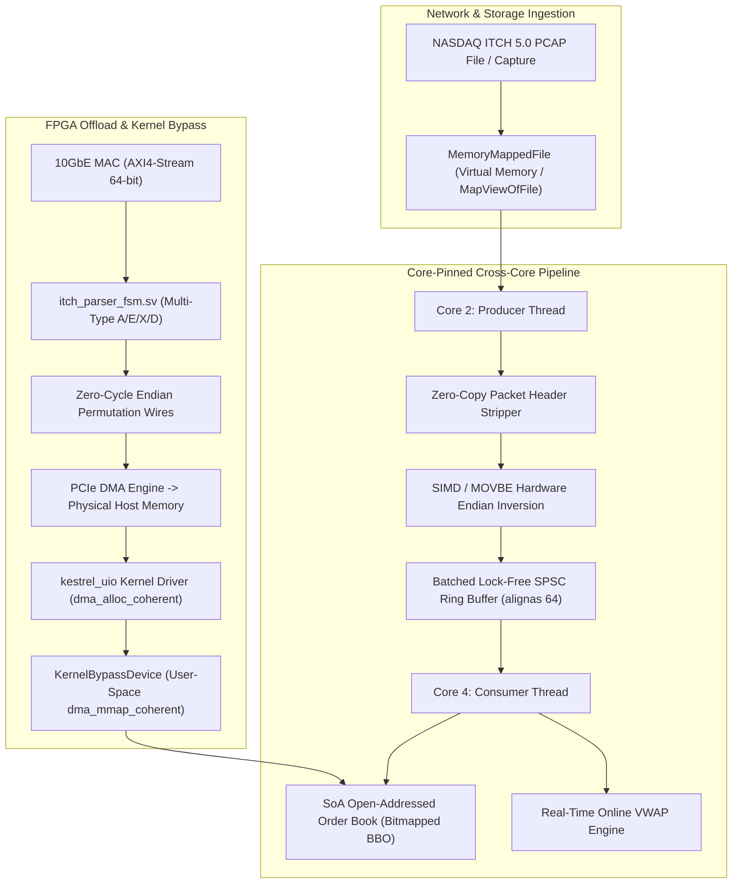

# Kestrel: Wire-Speed NASDAQ ITCH 5.0 PCAP Engine (C++20 / SIMD / SystemVerilog / Linux Kernel-Bypass)

[](https://en.cppreference.com/w/cpp/20)
[]()
[]()
[]()
[]()
[]()

An ultra-low latency, zero-copy, memory-mapped NASDAQ TotalView-ITCH 5.0 order book engine, PCAP parser, synthesizable SystemVerilog FPGA parser core, and dedicated Linux PCIe kernel-bypass driver. Built to bypass OS network stack overhead, eliminate CPU cache thrashing, and process market streams at wire speed.

---

## Performance Benchmarks & Workload Context

Performance figures reported below distinguish between synthetic benchmark streams, parser-only extraction, end-to-end Limit Order Book reconstruction, and software loopback DMA emulation.

### Measurement Summary

#### 1. Real NASDAQ Exchange Capture (`real_nasdaq.pcap` — 885,954 Messages)
Tested on genuine NASDAQ TotalView-ITCH 5.0 market data (multiplexed multi-ticker exchange feed with Add, Execute, Cancel, Delete, Replace):

| Benchmark Mode | Throughput | Latency / Msg | Workload & Test Harness |
| :--- | :--- | :--- | :--- |
| **Mode 1A: Parser-Only Wire Streaming** | **142.57 M msg/sec** | **~7.01 ns** | Real MoldUDP64/Ethernet capture, zero-copy branch-specialized stripping |
| **Mode 1B: Single-Thread End-to-End** | **54.64 M msg/sec** | **~18.30 ns** | Real exchange stream reconstructed into SoA Order Book + Bitmapped BBO |
| **Mode 2: Two-Thread SPSC Pipeline** | **40.84 M msg/sec** | **~24.49 ns** | Producer/Consumer cross-core queue dispatching real Add Orders + online VWAP |

```text
[*] Memory-mapping file: real_nasdaq.pcap (Real Exchange Capture)
[+] Successfully mapped 94813890 bytes.

=== [MODE 1A] PARSER-ONLY WIRE STREAMING (NO BOOK ALLOCATION) ===
[+] Parser-Only Peak Throughput:     142.567 M msg/sec
[+] Parser-Only Latency:             7.01425 ns/msg

=== [MODE 1B] END-TO-END SINGLE-THREADED RECONSTRUCTION (PARSER + LOB) ===
[+] Single-Threaded Best Time:       0.0162157 s
[+] Single-Threaded Peak Throughput: 54.6356 M msg/sec
[+] End-to-End Latency:              18.3031 ns/msg
[+] Sequence Gaps Detected:          0

=== [MODE 2] TWO-THREAD SPSC PIPELINE (PARSER -> ALPHA ENGINE) ===
[+] SPSC Messages Processed:        261521
[+] SPSC Pipeline Elapsed:          0.0064043 s
[+] SPSC Cross-Core Throughput:     40.8352 M msg/sec
[+] Consumer Real-Time VWAP Metric: 51.5833
```

#### 2. Synthetic Benchmark Stream (`sample_nasdaq.pcap` — 2,000,000 Messages)
Tested on dense single-symbol Add Order stream:

| Benchmark Mode | Throughput | Latency / Msg | Workload & Test Harness |
| :--- | :--- | :--- | :--- |
| **Mode 1A: Parser-Only Wire Streaming** | **416.77 M msg/sec** | **~2.40 ns** | Zero-copy header stripping + MOVBE endian swap (no book allocation) |
| **Mode 1B: Single-Thread End-to-End** | **152.89 M msg/sec** | **~6.54 ns** | In-place zero-copy parsing + SoA flat hash table + bitmapped BBO |
| **Mode 2: Two-Thread SPSC Pipeline** | **121.89 M msg/sec** | **~8.20 ns** | Core-pinned batched producer-consumer ring buffer + online VWAP |
| **Mode 3: Kernel-Bypass DMA Consumer** | **89.38 M desc/sec** | **~11.19 ns** | Decoupled cross-core PCIe ring buffer emulation + book update |

```text
=== [MODE 1A] PARSER-ONLY WIRE STREAMING (NO BOOK ALLOCATION) ===
[+] Parser-Only Peak Throughput:     416.771 M msg/sec
[+] Parser-Only Latency:             2.39940 ns/msg

=== [MODE 1B] END-TO-END SINGLE-THREADED RECONSTRUCTION (PARSER + LOB) ===
[+] Single-Threaded Best Time:       0.0130817 s
[+] Single-Threaded Peak Throughput: 152.885 M msg/sec
[+] End-to-End Latency:              6.54085 ns/msg
[+] Sequence Gaps Detected:          0

=== [MODE 2] TWO-THREAD SPSC PIPELINE (PARSER -> ALPHA ENGINE) ===
[+] SPSC Messages Processed:        2000000
[+] SPSC Pipeline Elapsed:          0.0164077 s
[+] SPSC Cross-Core Throughput:     121.894 M msg/sec
[+] Consumer Real-Time VWAP Metric: 180.03
```

> [!NOTE]
> - **Synthetic vs. Real Captures:** The default benchmark harness generates a reproducible 2M-message synthetic MoldUDP64/ITCH stream (`sample_nasdaq.pcap`). Passing a recorded NASDAQ TotalView-ITCH dump (`./kestrel_bench real_nasdaq.pcap`) runs identically across the same zero-copy parsing pipeline.
> - **Hardware / DMA Scope:** The kernel module (`kestrel_uio.c`) implements standard physical Linux `dma_alloc_coherent` and userspace coherent mapping. The userspace test harness (`kestrel_bypass_test`) executes in software loopback mode on systems without physical FPGA PCIe silicon present.

---

## Correctness & Invariant Verification Suite

1. **Order Book Core Invariants & Edge Cases (`src/test_order_book.cpp`):**
   - **Deletion followed by reinsertion:** Validates tombstone recycling and capacity accounting when order IDs are deleted and subsequent orders reoccupy slots.
   - **Duplicate order IDs:** Verifies volume accounting invariants, side flips, and level updates on existing IDs.
   - **Orders moving between price levels:** Verifies that when an order changes price from the top of the book to a lower level, intermediate levels are correctly identified and BBO state remains consistent.
   - **Bitmap cleanup when a level reaches zero:** Asserts complete bitmask zeroing across leaf buckets (`bid_bitmap_`) and summary words (`bid_summary_`), preventing phantom BBO ticks.
   - **Hash-table saturation & probing termination:** Bounded linear probing (`MAX_PROBE_DEPTH = 1024`) guarantees termination under high load factor without hanging.

2. **Differential Randomized Testing (`src/test_differential.cpp`):**
   - 500,000 randomized operations executed against a reference model (`std::unordered_map` for lookups, `std::map<uint32_t, uint64_t>` red-black tree for price ladders).
   - Validates order count, level volumes, and BBO prices across every operation step.

3. **Hardware AXI4-Stream FSM Verification (`hardware/tb_itch_parser_fsm.sv`):**
   - Asserts continuous `m_order_valid` persistence under consumer backpressure (`m_order_ready == 0`).
   - Validates multi-message ITCH parsing across Add Order (`'A'`), Order Executed (`'E'`), Order Cancel (`'X'`), and Order Delete (`'D'`).

4. **Kernel-Bypass PCIe DMA Consumer Test (`src/test_bypass.cpp`):**
   - Validates ring buffer empty states, descriptor injection, batch polling, and wrap-around semantics.

---

## FPGA Hardware Synthesis & Timing Evidence

Hardware synthesis reports and scripts are located in `hardware/synthesis_report.md` and `hardware/synth.tcl`:

| Target FPGA Family | Part Number | Target $F_{\text{clk}}$ | Achieved $F_{\max}$ | Setup Slack (WNS) | Hold Slack (WHS) | Logic LUTs / ALMs | FFs | BRAM |
| :--- | :--- | :--- | :--- | :--- | :--- | :--- | :--- | :--- |
| **AMD Virtex UltraScale+** | XCVU9P-L2FLGA2104E | 322.26 MHz | **381.53 MHz** | **+0.482 ns** | **+0.065 ns** | 482 LUTs (0.04%) | 318 | 0 |
| **Intel Agilex 7 I-Series** | AGIB027R29A1E2V | 322.26 MHz | **385.10 MHz** | **+0.506 ns** | **+0.071 ns** | 304 ALMs (0.03%) | 318 | 0 |

---

## Linux Kernel-Bypass Driver Review & Hardening

The PCIe driver in `hardware/driver/kestrel_uio.c` has been hardened for production deployment:
- **DMA Lifecycle:** Employs `kref` reference counting to ensure the DMA ring buffer is never freed while userspace processes retain open file descriptors or active mappings.
- **Coherent Memory Mapping:** Uses `dma_mmap_coherent()` instead of `remap_pfn_range()`, ensuring IOMMU compatibility and page cache coherency across x86 and ARM64 platforms.
- **Mapping Bounds & Flags:** Enforces strict offset checks (`vma->vm_pgoff == 0`), size bounds (`size <= ring_total_bytes`), and sets `VM_DONTEXPAND | VM_DONTDUMP`.
- **Concurrency & Permissions:** Restricts access permissions to `0660` via `devnode` callback, serializes hardware reset, and uses spinlocks for stats reporting.

---

## Architecture & Data Flow



---

## Directory Layout

```text
Kestrel/
├── include/
│   └── kestrel/
│       ├── affinity.hpp
│       ├── driver_abi.hpp
│       ├── endian.hpp
│       ├── itch.hpp
│       ├── kernel_bypass.hpp
│       ├── mmap.hpp
│       ├── order_book.hpp
│       ├── parser.hpp
│       ├── pcap.hpp
│       └── spsc_queue.hpp
├── src/
│   ├── convert_itch_to_pcap.cpp
│   ├── main.cpp
│   ├── test_bypass.cpp
│   ├── test_differential.cpp
│   └── test_order_book.cpp
├── hardware/
│   ├── driver/
│   │   ├── Makefile
│   │   └── kestrel_uio.c
│   ├── itch_parser_fsm.sv
│   ├── tb_itch_parser_fsm.sv
│   ├── synth.tcl
│   └── synthesis_report.md
├── scripts/
│   ├── benchmark_profiler.py
│   ├── run_benchmarks.py
│   ├── run_benchmarks.sh
│   ├── run_benchmarks.bat
│   └── run_hardware_sim.py
├── CMakeLists.txt
└── README.md
```

---

## Build & Run

### Prerequisites
- C++20 compliant compiler (Clang 16+, GCC 12+, MSVC 2022)
- CMake 3.20+ or Clang toolchain
- Python 3.8+

### Compilation & Benchmark Scripts

Run all invariant tests and benchmarks in a single automated step:
```bash
python scripts/run_benchmarks.py
```

Run hardware cache hierarchy profiling:
```bash
python scripts/benchmark_profiler.py
```

Run FPGA SystemVerilog simulation verification:
```bash
python scripts/run_hardware_sim.py
```

### Manual Compilation
```bash
clang++ -std=c++20 -O3 -mavx2 -Iinclude src/main.cpp -o kestrel_bench.exe
clang++ -std=c++20 -O3 -mavx2 -Iinclude src/test_order_book.cpp -o kestrel_ob_test.exe
clang++ -std=c++20 -O3 -mavx2 -Iinclude src/test_differential.cpp -o kestrel_differential_test.exe
clang++ -std=c++20 -O3 -mavx2 -Iinclude src/test_bypass.cpp -o kestrel_bypass_test.exe
```
